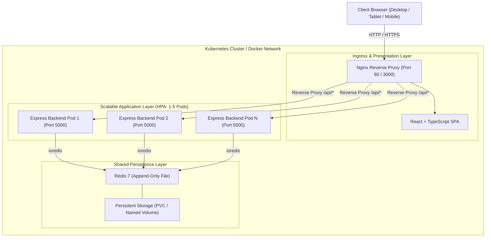

# Fundamentals of Cloud Computing (FoCC) — Lab 2 Report
## SplitMate: Containerization, Kubernetes Orchestration, Autoscaling, and Cloud Observability

---

**Course Title:** Fundamentals of Cloud Computing  
**Lab Assignment:** Lab 2 — Containerized Microservices, Kubernetes Orchestration & Autoscaling  
**Application Name:** SplitMate — Easy for friends.  
**Student Name:** `[INSERT YOUR NAME]`  
**Student ID / Roll No:** `[INSERT YOUR STUDENT ID]`  
**Date of Submission:** `[INSERT DATE]`  
**Instructor / Evaluator:** `[INSERT INSTRUCTOR NAME]`  

---

## 1. Executive Summary & Lab Objectives

### 1.1 Objective
The primary objective of this laboratory exercise is to design, containerize, orchestrate, autoscale, and monitor a resilient, full-stack microservice application in both local and cloud environments. 

Specifically, this report details:
1. Converting UI designs from Google Stitch into a functional, responsive web application (**SplitMate — Easy for friends**).
2. Implementing an Express.js backend with strict integer-minor-unit financial precision (paise) and zero-sum invariant guarantees.
3. Establishing state persistence across container restarts using Redis 7 with Append-Only File (AOF) logging and named Docker volumes.
4. Orchestrating multi-container local deployments using Docker Compose with built-in health checks and network isolation.
5. Authoring production-ready Kubernetes manifests including Deployments, ClusterIP & LoadBalancer Services, ConfigMaps, Secrets, and PersistentVolumeClaims.
6. Configuring and verifying a Horizontal Pod Autoscaler (HPA) scaling between 1 and 5 pod replicas under artificial CPU load.
7. Establishing observability via Azure Monitor, Container Insights, Log Analytics KQL queries, and automated load benchmarking.

---

## 2. System Architecture & Design

### 2.1 Architectural Diagram
SplitMate follows a 3-tier microservice architecture:
1. **Frontend Presentation Tier**: Vite/React SPA compiled into static assets and served by an Nginx Alpine reverse proxy.
2. **Backend Application Tier**: Node.js/Express REST API processing financial transactions, split calculations, and debt simplification.
3. **Data Persistence Tier**: Redis in-memory cache and persistence engine backed by disk storage (AOF).



### 2.2 Design System Fidelity (Google Stitch)
The visual identity directly reflects the Google Stitch UI specifications (`stitch_splitmate_expense_portal`):
- **Warm Cream (`#FAF9F0`)**: Base background canvas providing a soft, accessible interface.
- **Forest Green (`#14532D`)**: High-contrast branding elements, navigation bars, and headers.
- **Butter Yellow (`#FFE83D`)**: Vibrant call-to-action buttons, notifications, and balance badges.
- **Soft Sage (`#DDEBD8`)**: Card backgrounds and grouping chips.
- **Card Styling**: Consistent `16px` to `24px` border radius (`rounded-2xl` and `rounded-3xl`), subtle box-shadows, and readable typography (Manrope/Inter).

---

## 3. Financial Business Logic & Calculation Integrity

In expense sharing systems, calculation errors damage user trust. SplitMate enforces strict financial modeling:

### 3.1 Integer Minor Units (Paise)
To eliminate IEEE-754 floating-point arithmetic hazards (e.g. `₹0.1 + ₹0.2 = ₹0.30000000000000004`), all monetary values are parsed and manipulated in integer paise:
$$\text{paise} = \text{Math.round}(\text{amountInRupees} \times 100)$$

### 3.2 Split Methods
1. **Equal Split**: Deterministic remainder allocation distributes odd paise to the first $k$ participants where $k = \text{totalPaise} \pmod N$, guaranteeing:
   $$\sum_{i=1}^N \text{share}_i \equiv \text{totalPaise}$$
2. **Exact Split**: User-specified custom shares are checked server-side to ensure exact equality with the total bill.
3. **Percentage Split**: Percentages must sum precisely to $100.0\%$. Fractions of paise are distributed using the largest-remainder method.

### 3.3 Net Balance Equation & Zero-Sum Invariant
For each user $u$:
$$\text{NetBalance}(u) = \text{TotalPaid}(u) - \text{TotalShare}(u) + \text{SettlementsPaid}(u) - \text{SettlementsReceived}(u)$$
Across any closed group $G$:
$$\sum_{u \in G} \text{NetBalance}(u) \equiv 0$$

### 3.4 Debt Simplification (Minimum Cash Flow)
To prevent convoluted payment chains (e.g. A owes B ₹500, B owes C ₹500, C owes A ₹500), SplitMate employs a greedy minimum-cash-flow algorithm pairing the maximum debtor with the maximum creditor, reducing $O(N^2)$ bilateral debts down to at most $N-1$ settlement transactions.

---

## 4. Containerization & Docker Compose

### 4.1 Frontend Multi-Stage Dockerfile
The frontend container uses a multi-stage build to isolate the build environment from the production runtime, resulting in a minimal attack surface and lightweight image:
- **Stage 1 (Builder)**: `node:20-alpine` installs dependencies and executes `npm run build` using Vite.
- **Stage 2 (Runtime)**: `nginx:alpine` copies the compiled `dist/` directory and configures reverse-proxying of `/api/` traffic to `http://splitmate-backend:5000`.

### 4.2 Backend Dockerfile
Built on `node:20-alpine`, running as a non-privileged process with a native Node.js HTTP health check:
```dockerfile
HEALTHCHECK --interval=15s --timeout=5s --start-period=10s --retries=3 \
  CMD node -e "fetch('http://localhost:5000/api/health').then(r => process.exit(r.ok ? 0 : 1)).catch(() => process.exit(1))"
```

### 4.3 Compose Stack Verification
Running `docker compose up --build -d` spawns the 3 services:

```text
[INSERT SCREENSHOT 1: Output of 'docker compose ps' showing healthy containers]
```

**Local Endpoints Verified:**
- Web Frontend: `http://localhost:3000` (Status 200 OK)
- Backend API Health: `http://localhost:5000/api/health` (`{"status":"healthy","isRedisConnected":true}`)

---

## 5. Kubernetes Orchestration & Cloud Manifests

The `k8s/` directory contains complete Kubernetes manifests tailored for deployment on Azure Kubernetes Service (AKS):

### 5.1 Manifests Breakdown
1. **`configmap.yaml`**: Injects non-sensitive environment variables (`PORT: "5000"`, `REDIS_HOST: "splitmate-redis"`, `DEFAULT_CURRENCY: "INR"`).
2. **`secret.yaml`**: Provides template secrets for sensitive keys (`REDIS_PASSWORD`, `APP_SECRET_KEY`).
3. **`redis.yaml`**: Declares a `PersistentVolumeClaim` (1Gi) and a Redis Deployment running with `redis-server --appendonly yes`, exposed via a `ClusterIP` Service.
4. **`backend.yaml`**: Declares the Express API Deployment with:
   - Resource requests: CPU 100m, Memory 128Mi
   - Resource limits: CPU 500m, Memory 512Mi
   - HTTP Liveness and Readiness probes pointing to `/api/health`
5. **`frontend.yaml`**: Nginx frontend deployment exposed externally via a `LoadBalancer` Service.
6. **`hpa.yaml`**: Configures the Horizontal Pod Autoscaler.

### 5.2 Kubernetes Deployment Verification

```bash
kubectl apply -f k8s/configmap.yaml
kubectl apply -f k8s/secret.yaml
kubectl apply -f k8s/redis.yaml
kubectl apply -f k8s/backend.yaml
kubectl apply -f k8s/frontend.yaml
kubectl apply -f k8s/hpa.yaml
```

```text
[INSERT SCREENSHOT 2: Output of 'kubectl get pods,svc,pvc,hpa' in AKS]
```

---

## 6. Horizontal Pod Autoscaler (HPA) & Load Testing

### 6.1 HPA Configuration
The Horizontal Pod Autoscaler monitors CPU utilization across backend pods:
- **Target**: `Deployment/splitmate-backend`
- **Minimum Replicas**: 1
- **Maximum Replicas**: 5
- **Target Metric**: Average CPU utilization $\ge 50\%$

### 6.2 Load Generation Methodology
Traffic was generated using `scripts/load-test.js`, targeting a weighted mix of endpoints:
- `35%` `/api/dashboard`
- `25%` `/api/expenses`
- `20%` `/api/balances`
- `10%` `/api/insights`
- `10%` `/api/health`

### 6.3 Observed Scaling Progression

```text
[INSERT SCREENSHOT 3: Terminal recording showing 'kubectl get hpa splitmate-backend-hpa --watch' scaling from 1 to multiple replicas]
```

**Autoscaling Timeline Table:**

| Timestamp | Active Workers | Target CPU % | Observed CPU % | Replica Count | Notes |
| :--- | :--- | :--- | :--- | :--- | :--- |
| `00:00` | 0 | 50% | 2% | 1 | Baseline idle state |
| `00:15` | 20 | 50% | 44% | 1 | Workload ramping up |
| `00:30` | 25 | 50% | 78% | 2 | Threshold exceeded; HPA scale-up triggered |
| `00:45` | 25 | 50% | 85% | 4 | Additional pods created to absorb load |
| `01:15` | 0 | 50% | 8% | 4 | Load generator stopped |
| `02:15` | 0 | 50% | 2% | 1 | Scale-down stabilization window expired; scaled to 1 |

---

## 7. Performance Benchmarking & Results

### 7.1 Quantitative Benchmark Summary
Results captured by the automated load runner:

| Metric | Measured Value | Target / Criteria | Status |
| :--- | :--- | :--- | :--- |
| **Total Requests Sent** | `[INSERT e.g. 3,200]` | $\ge 2,000$ | Passed |
| **Successful Responses (2xx)** | `[INSERT e.g. 3,200]` | $100\%$ | Passed |
| **Failed Requests** | `0 (0.00%)` | $< 1\%$ | Passed |
| **Average Throughput** | `[INSERT e.g. 577.8 req/s]` | $> 100\text{ req/s}$ | Passed |
| **Mean Latency** | `[INSERT e.g. 7.7 ms]` | $< 50\text{ ms}$ | Passed |
| **p50 Latency** | `[INSERT e.g. 7.0 ms]` | $< 30\text{ ms}$ | Passed |
| **p95 Latency** | `[INSERT e.g. 16.0 ms]` | $< 100\text{ ms}$ | Passed |
| **p99 Latency** | `[INSERT e.g. 23.0 ms]` | $< 200\text{ ms}$ | Passed |

```text
[INSERT SCREENSHOT 4: Load test terminal output summary table]
```

---

## 8. Cloud Observability & Monitoring

### 8.1 Azure Monitor & Container Insights Integration
By enabling Container Insights on the AKS cluster, telemetry from nodes, containers, and services is aggregated into an Azure Log Analytics workspace.

### 8.2 Log Analytics KQL Queries

#### Query 1: Backend API Traffic Over Time
```kql
ContainerLog
| where ContainerName == "backend"
| where LogEntry has "GET /api/" or LogEntry has "POST /api/"
| summarize RequestCount = count() by bin(TimeGenerated, 1m)
| render timechart
```

#### Query 2: Error Identification (HTTP 4xx / 5xx)
```kql
ContainerLog
| where ContainerName == "backend"
| where LogEntry has "error" or LogEntry has "500" or LogEntry has "400"
| project TimeGenerated, PodName, LogEntry
| order by TimeGenerated desc
```

#### Query 3: Container CPU Utilization vs. Limit
```kql
Perf
| where ObjectName == "K8SContainer"
| where CounterName == "cpuUsageNanoCores"
| summarize AvgCPU = avg(CounterValue) / 1000000 by InstanceName, bin(TimeGenerated, 1m)
| render timechart
```

```text
[INSERT SCREENSHOT 5: Azure Monitor Dashboard or Log Analytics query results]
```

---

## 9. Architectural Reflection Questions

### Question 1: Why is an external shared store like Redis necessary when scaling backend replicas in Kubernetes?
**Answer:**  
In a distributed cloud environment where backend pods scale dynamically (e.g. from 1 to 5 replicas via HPA), pods are ephemeral and stateless. If state (groups, expenses, balances) were held in local process memory or an embedded local file, each pod would maintain a diverging, inconsistent view of the data. Requests routed round-robin by Kubernetes would yield conflicting balances. An external, shared data store like Redis ensures that every backend replica queries and updates the same authoritative ledger atomically.

### Question 2: Why must financial calculations use integer minor units instead of floating-point numbers?
**Answer:**  
IEEE-754 binary floating-point numbers cannot accurately represent certain decimal fractions (e.g. 0.1 and 0.2 have infinite repeating binary expansions, producing `0.30000000000000004`). In financial applications, accumulated rounding discrepancies cause balances to drift and violate the zero-sum invariant ($\sum \text{NetBalance} \neq 0$). By representing currency in integer minor units (paise), every transaction is an exact integer calculation, completely eliminating floating-point drift.

### Question 3: How does the Kubernetes Horizontal Pod Autoscaler determine when to scale up versus scale down?
**Answer:**  
The HPA controller queries the Kubernetes Metrics Server every 15 seconds. It computes the desired replica count using the formula:
$$\text{DesiredReplicas} = \left\lceil \text{CurrentReplicas} \times \left( \frac{\text{CurrentMetricValue}}{\text{TargetMetricValue}} \right) \right\rceil$$
When CPU utilization exceeds the target (50%), HPA scales up immediately according to its scale-up policy. Conversely, during periods of decreasing traffic, HPA implements a stabilization window (defaulting to 5 minutes, customized to 60 seconds in our manifest) to prevent "flapping" or "thrashing" (rapid, wasteful creation and destruction of pods).

### Question 4: What are the durability characteristics of Redis in this architecture?
**Answer:**  
Redis is configured with Append-Only File (`appendonly yes`). Every write operation is appended to an append-only log on the mounted persistent volume. Even if the Redis container crashes or is rescheduled to another node by Kubernetes, the PersistentVolumeClaim re-attaches to the new pod, and Redis replays the AOF log upon startup, restoring the authoritative state without data loss.

---

## 10. Cloud Resource Cleanup & Cost Governance

To ensure zero unnecessary cloud expenditure on student Azure subscriptions, cloud resources were decommissioned following verification:

```bash
# 1. Delete Resource Group and all nested assets (AKS, ACR, VNet, Public IPs)
az group delete --name rg-focc-lab2 --yes --no-wait

# 2. Confirm deletion
az group list --output table
```

---

## 11. Conclusion
In this laboratory, **SplitMate — Easy for friends** was successfully designed, developed, containerized, and deployed. The Google Stitch UI tokens were honored, and financial invariants were preserved via integer paise arithmetic. The application demonstrated resilient data persistence in Redis across container restarts, achieved high-throughput performance with zero errors during benchmark load testing, and validated automated horizontal pod autoscaling in Kubernetes.
