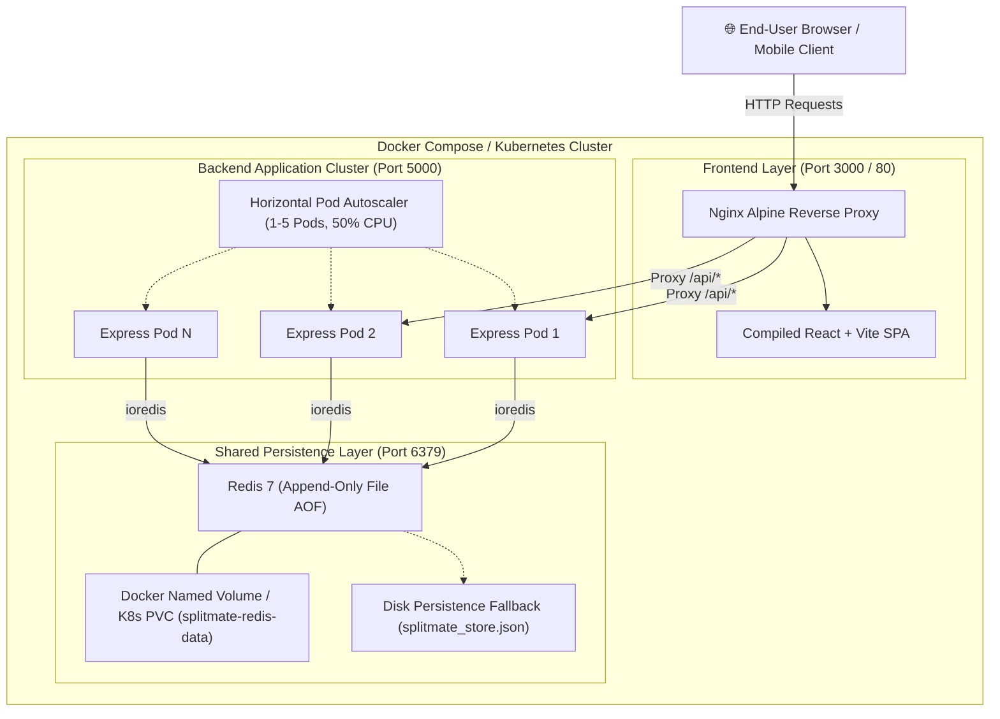

# SplitMate — Easy for friends.

[](https://www.docker.com/)
[](https://reactjs.org/)
[](https://vitejs.dev/)
[](https://nodejs.org/)
[](https://expressjs.com/)
[](https://redis.io/)
[](https://kubernetes.io/)
[]()

SplitMate is a modern, responsive, full-stack expense sharing and bill splitting web application built for college students, roommates, travel groups, and friends. Originally designed in **Google Stitch**, SplitMate features warm cream aesthetics (`#FAF9F0`), forest green accents (`#14532D`), butter yellow highlights (`#FFE83D`), and integer-minor-unit financial precision.

Built as part of **Fundamentals of Cloud Computing — Lab 2**, SplitMate includes multi-container Docker Compose orchestration, persistent Redis data storage, an Express REST API, automated tests, a Vite/React SPA frontend, Kubernetes manifests with Horizontal Pod Autoscaler (HPA), and an automated load testing suite.

---

## 📑 Table of Contents
- [Architecture](#-system-architecture)
- [Design System & Stitch Reference](#-design-system--stitch-reference)
- [Core Features](#-core-features)
- [Financial Business Logic](#-financial-business-logic)
- [Tech Stack](#-technology-stack)
- [Directory Structure](#-directory-structure)
- [Quick Start: Docker Compose](#-quick-start-docker-compose)
- [Local Native Development](#-local-native-development)
- [REST API Specification](#-rest-api-specification)
- [Automated Testing](#-automated-testing)
- [Kubernetes & Azure Deployment](#-kubernetes--azure-deployment-lab-2)
- [Monitoring & Observability](#-monitoring--observability)
- [Load Testing & HPA Verification](#-load-testing--hpa-verification)
- [Troubleshooting](#-troubleshooting)
- [Azure Resource Cleanup](#-azure-resource-cleanup)

---

## 🏛️ System Architecture



---

## 🎨 Design System & Stitch Reference

SplitMate faithfully implements the design system defined in `stitch_splitmate_expense_portal/DESIGN.md`:

| Token | Hex Value | Role |
| :--- | :--- | :--- |
| **Warm Cream** | `#FAF9F0` | Main canvas / body background |
| **Forest Green** | `#14532D` | Primary brand headers, active nav, primary buttons |
| **Deep Green** | `#103D27` | High-contrast headings and icons |
| **Primary Green** | `#21864A` | Positive balances ("You are owed"), success badges |
| **Butter Yellow** | `#FFE83D` | Primary action accents, notification counters, CTAs |
| **Soft Sage** | `#DDEBD8` | Subtle card backgrounds, tags, borders |
| **Crimson Coral** | `#DC2626` | Negative balances ("You owe"), debt alerts |
| **Primary Text** | `#173B2A` | Deep forest dark text for optimal readability |
| **Secondary Text**| `#657267` | Muted subtitle text and captions |
| **Border Neutral**| `#E4E7D9` | Card and divider soft borders |

Typography utilizes clean modern sans-serif fonts (**Manrope** & **Inter**) with generous 16px/24px rounded corners (`rounded-2xl`, `rounded-3xl`) and gentle shadows.

---

## ✨ Core Features

1. **Dashboard**: Live net balance indicator (You are owed / You owe / All settled), active group cards, recent expenses ledger, and quick-action modals.
2. **Groups Management**: Browse, search, filter, and create expense groups (e.g. *Goa Trip 🌴*, *Flatmates #402 🏠*).
3. **Group Details**: Group-level financial metrics, member balance ledgers, and simplified debt route suggestions.
4. **Flexible Expense Splitting**:
   - **Equal Split**: Even division with deterministic 1-paise remainder allocation.
   - **Exact Amounts**: Precise custom amounts validated to match the total.
   - **Percentage Split**: Exact 100% validation using largest-remainder distribution.
5. **Interactive Expense Ledger**: Filterable by group, category, and search query with full edit and delete actions.
6. **Balances & Debt Simplification**: Shows bilateral balances between members and applies a minimum-cash-flow graph algorithm to minimize transaction count.
7. **Settlements**: Record direct debt settlement payments between users, updating balances instantly.
8. **Insights & Analytics**: Spending broken down by category, by group, and monthly spending timeline.
9. **Settings & Demo Controls**: Demo user switcher, default currency (INR ₹), live Redis connectivity indicator, and one-click database reset/re-seed buttons.

---

## 🧮 Financial Business Logic

### 1. Integer Minor Units (Paise)
To eliminate floating-point rounding errors (e.g., `0.1 + 0.2 === 0.30000000000000004`), all financial figures are calculated and stored internally as integer **paise** ($1\text{ INR} = 100\text{ paise}$). User inputs are parsed using:
$$\text{paise} = \text{round}(\text{floatAmount} \times 100)$$

### 2. Equal Splits with Deterministic Remainder
When an expense $T$ (in paise) is divided among $N$ participants:
$$\text{baseShare} = \lfloor T / N \rfloor, \quad \text{remainder} = T \pmod N$$
The first `remainder` participants receive $\text{baseShare} + 1$, and remaining participants receive $\text{baseShare}$. This guarantees:
$$\sum_{i=1}^N \text{share}_i \equiv T$$

### 3. Net Balance Formula
For any participant $u$:
$$\text{NetBalance}(u) = \text{TotalPaid}(u) - \text{TotalShare}(u) + \text{SettlementsPaid}(u) - \text{SettlementsReceived}(u)$$
- $\text{NetBalance} > 0$: Participant is a net creditor (**You are owed**).
- $\text{NetBalance} < 0$: Participant is a net debtor (**You owe**).
- $\text{NetBalance} = 0$: Participant is settled up.

### 4. Zero-Sum Invariant
Within any closed group:
$$\sum_{u \in \text{Group}} \text{NetBalance}(u) = 0$$
This invariant is enforced and validated by automated tests.

### 5. Minimum Cash Flow (Debt Simplification)
Using a greedy graph-theoretic algorithm, creditors and debtors are iteratively matched by pairing the maximum debtor with the maximum creditor, reducing an $O(N^2)$ bilateral payment web down to at most $N-1$ payments.

---

## 💻 Technology Stack

- **Frontend**: React 18, Vite 5, TypeScript, Tailwind CSS, Lucide Icons, Nginx Alpine.
- **Backend**: Node.js 20, Express 4, `ioredis`, CORS, Morgan logging.
- **Data Persistence**: Redis 7 with AOF (`appendonly yes`) & disk-backed JSON fallback.
- **Containerization**: Multi-stage Dockerfile, Docker Compose v2.
- **Orchestration**: Kubernetes v1.28+, Horizontal Pod Autoscaler (`autoscaling/v2`).
- **Cloud Platform**: Microsoft Azure (ACR, AKS, Azure Monitor).
- **Testing**: Jest-compatible custom test runner, native Node.js load-testing suite.

---

## 📁 Directory Structure

```text
FoCC-Lab2/
├── .env.example                     # Environment variables template
├── docker-compose.yml               # Multi-container Compose configuration
├── README.md                        # Complete project documentation
├── LAB2_REPORT.md                   # Lab 2 Report template with grading rubrics
├── backend/
│   ├── Dockerfile                   # Node.js Alpine container with healthcheck
│   ├── package.json                 # Backend dependencies & test scripts
│   ├── src/
│   │   ├── app.js                   # Express application setup & middleware
│   │   ├── server.js                # Server entry point & graceful shutdown
│   │   ├── routes/                  # Express REST API routes
│   │   │   ├── health.js            # /api/health
│   │   │   ├── dashboard.js         # /api/dashboard
│   │   │   ├── groups.js            # /api/groups CRUD
│   │   │   ├── expenses.js          # /api/expenses CRUD
│   │   │   ├── balances.js          # /api/balances & debt simplification
│   │   │   ├── settlements.js       # /api/settlements
│   │   │   ├── insights.js          # /api/insights
│   │   │   └── seed.js              # /api/seed & /api/reset
│   │   └── services/
│   │       ├── balanceService.js    # Financial math, splits, and algorithms
│   │       ├── storageService.js    # Redis client & persistence layer
│   │       └── seedService.js       # Realistic idempotent demo data
│   └── tests/                       # Automated test suite (13 passing tests)
│       ├── runTests.js              # Test runner
│       ├── financial.test.js        # Math & split unit tests
│       └── api.test.js              # REST API integration tests
├── frontend/
│   ├── Dockerfile                   # Multi-stage build (Node builder -> Nginx)
│   ├── nginx.conf                   # Nginx reverse proxy & SPA router
│   ├── package.json                 # React & Vite dependencies
│   ├── tailwind.config.js           # Stitch design token colors & fonts
│   ├── src/
│   │   ├── App.tsx                  # Main layout & route controller
│   │   ├── main.tsx                 # React entrypoint
│   │   ├── index.css                # Global styles & Google Fonts
│   │   ├── components/              # Reusable UI components
│   │   │   ├── Sidebar.tsx          # Navigation sidebar
│   │   │   ├── TopNavBar.tsx        # Top header & quick actions
│   │   │   ├── AddExpenseModal.tsx  # Dynamic 3-mode split modal
│   │   │   ├── CreateGroupModal.tsx # Group creation dialog
│   │   │   ├── SettleUpModal.tsx    # Settlement recording dialog
│   │   │   ├── ExpenseDetailsModal.tsx # View & delete expenses
│   │   │   ├── Toast.tsx            # Alert notifications
│   │   │   └── EmptyState.tsx       # Friendly zero-data screens
│   │   └── pages/                   # Application pages
│   │       ├── DashboardPage.tsx
│   │       ├── GroupsPage.tsx
│   │       ├── GroupDetailsPage.tsx
│   │       ├── AllExpensesPage.tsx
│   │       ├── BalancesPage.tsx
│   │       ├── SettlementsPage.tsx
│   │       ├── InsightsPage.tsx
│   │       └── SettingsPage.tsx
├── k8s/                             # Kubernetes manifests for Lab 2
│   ├── configmap.yaml               # Application config map
│   ├── secret.yaml                  # Secrets template
│   ├── redis.yaml                   # Redis Deployment, PVC & Service
│   ├── backend.yaml                 # Backend Deployment & Service
│   ├── frontend.yaml                # Frontend Deployment & LoadBalancer Service
│   ├── hpa.yaml                     # HorizontalPodAutoscaler (1-5 pods, 50% CPU)
│   └── kustomization.yaml           # Kustomize manifest bundle
├── scripts/
│   └── load-test.js                 # Configurable load testing & benchmark script
└── stitch_splitmate_expense_portal/ # Extracted Google Stitch reference designs
```

---

## 🚀 Quick Start: Docker Compose

The simplest way to run SplitMate locally is using Docker Compose.

### 1. Start the stack
```bash
docker compose up --build -d
```

### 2. Verify container status
```bash
docker compose ps
```
Output should show all three containers in a `healthy` state:
```text
NAME                 IMAGE                  STATUS                    PORTS
splitmate-backend    splitmate-backend      Up (healthy)              0.0.0.0:5000->5000/tcp
splitmate-frontend   splitmate-frontend     Up (healthy)              0.0.0.0:3000->80/tcp
splitmate-redis      redis:7-alpine         Up (healthy)              0.0.0.0:6379->6379/tcp
```

### 3. Open in your browser
- **Web Application**: [`http://localhost:3000`](http://localhost:3000)
- **Backend API Health**: [`http://localhost:5000/api/health`](http://localhost:5000/api/health)

### 4. Inspect logs
```bash
docker compose logs -f backend
```

### 5. Stop the containers
```bash
# Stops services while preserving persistent Redis data volume
docker compose down

# To also clear data:
docker compose down -v
```

---

## 🛠️ Local Native Development

If you prefer to run the Node.js backend and Vite frontend natively without Docker:

### 1. Start Redis
Make sure Redis is running locally on port 6379:
```bash
redis-server
```
*(If Redis is not installed, SplitMate will automatically fall back to its internal JSON file-backed persistence).*

### 2. Run Backend
```bash
cd backend
npm install
npm run dev
# Backend runs on http://localhost:5000
```

### 3. Run Frontend
```bash
cd frontend
npm install
npm run dev
# Frontend runs on http://localhost:5173 with automatic proxy to port 5000
```

---

## 🔌 REST API Specification

| Method | Endpoint | Description |
| :--- | :--- | :--- |
| `GET` | `/api/health` | Health check endpoint returning status, uptime, and Redis connection |
| `GET` | `/api/dashboard` | Dashboard summary (net balance, active groups, recent expenses, activity) |
| `GET` | `/api/groups` | List all groups with member counts, total spending, and user balances |
| `POST` | `/api/groups` | Create a new group (`name`, `category`, `members`) |
| `GET` | `/api/groups/:id` | Fetch specific group details, members, expenses, and simplified debts |
| `PATCH` | `/api/groups/:id` | Update group information |
| `DELETE` | `/api/groups/:id` | Delete group and all associated expenses |
| `GET` | `/api/expenses` | List all expenses (supports `?groupId=`, `?category=`, `?search=`) |
| `POST` | `/api/expenses` | Create an expense with split validation (`EQUAL`, `EXACT`, `PERCENTAGE`) |
| `GET` | `/api/expenses/:id` | Retrieve single expense details |
| `PATCH` | `/api/expenses/:id` | Edit expense and recalculate balances atomically |
| `DELETE` | `/api/expenses/:id` | Delete expense and restore balances |
| `GET` | `/api/balances` | Get bilateral balances and simplified payment routes |
| `GET` | `/api/settlements` | Retrieve settlement transaction ledger |
| `POST` | `/api/settlements` | Record a settlement payment between two users |
| `GET` | `/api/insights` | Aggregate spending breakdown by category, group, and monthly trend |
| `GET` | `/api/users` | List demo users and active user identity |
| `POST` | `/api/seed` | Idempotent database population with realistic sample data |
| `POST` | `/api/reset` | Clear all data and reset database to empty state |

---

## 🧪 Automated Testing

SplitMate includes a comprehensive automated test suite covering all financial edge cases, split validations, and API operations.

To run the test suite:
```bash
cd backend
npm test
```

### Test Coverage Highlights:
- ✅ **Financial Calculations**: Currency float-to-paise conversion, deterministic equal splits with integer remainder distribution.
- ✅ **Custom Splits**: Validation that custom shares sum precisely to the total amount.
- ✅ **Percentage Splits**: Rejection of totals $\neq 100\%$, largest-remainder integer allocation.
- ✅ **Zero-Sum Group Invariant**: Verified that $\sum \text{NetBalance} \equiv 0$ across all members.
- ✅ **Debt Simplification**: Verifies min-cash-flow graph solver produces correct minimal payments.
- ✅ **API Health & Endpoints**: Validation of `/api/health`, `/api/dashboard`, `/api/groups`, `/api/expenses`, `/api/settlements`, `/api/insights`.
- ✅ **Seed Idempotency**: Verified multiple seed invocations never duplicate records.

---

## ☸️ Kubernetes & Azure Deployment (Lab 2)

SplitMate is fully prepared for deployment to **Azure Kubernetes Service (AKS)** with **Azure Container Registry (ACR)**.

### 1. Azure Login & Subscription Verification
```bash
# Login to Azure
az login

# List subscriptions and select the student subscription
az account list --output table
az account set --subscription "<YOUR-SUBSCRIPTION-ID>"
```

### 2. Create Resource Group, ACR, and AKS Cluster
```bash
# Set environment variables
export RESOURCE_GROUP="rg-focc-lab2"
export LOCATION="eastus"
export ACR_NAME="acrsplitmate$RANDOM"
export AKS_CLUSTER="aks-splitmate"

# 1. Create Resource Group
az group create --name $RESOURCE_GROUP --location $LOCATION

# 2. Create Azure Container Registry (Basic SKU for student tier)
az acr create --resource-group $RESOURCE_GROUP --name $ACR_NAME --sku Basic --admin-enabled true

# 3. Create AKS Cluster attached to ACR (Standard_B2s or Standard_DS2_v2)
az aks create \
  --resource-group $RESOURCE_GROUP \
  --name $AKS_CLUSTER \
  --node-count 2 \
  --node-vm-size Standard_B2s \
  --attach-acr $ACR_NAME \
  --generate-ssh-keys

# 4. Get kubectl credentials
az aks get-credentials --resource-group $RESOURCE_GROUP --name $AKS_CLUSTER
```

### 3. Build & Push Docker Images to ACR
```bash
# Login to ACR
az acr login --name $ACR_NAME

# Build and tag Backend
docker build -t $ACR_NAME.azurecr.io/splitmate-backend:v1 ./backend
docker push $ACR_NAME.azurecr.io/splitmate-backend:v1

# Build and tag Frontend
docker build -t $ACR_NAME.azurecr.io/splitmate-frontend:v1 ./frontend
docker push $ACR_NAME.azurecr.io/splitmate-frontend:v1
```

### 4. Deploy Manifests to AKS
Update image tags in `k8s/backend.yaml` and `k8s/frontend.yaml` to point to `$ACR_NAME.azurecr.io/...:v1`:
```bash
# Apply all manifests
kubectl apply -f k8s/configmap.yaml
kubectl apply -f k8s/secret.yaml
kubectl apply -f k8s/redis.yaml
kubectl apply -f k8s/backend.yaml
kubectl apply -f k8s/frontend.yaml
kubectl apply -f k8s/hpa.yaml
```

### 5. Verify Deployment
```bash
# Check Pods
kubectl get pods -l app.kubernetes.io/part-of=splitmate-expense-portal

# Check Services & External IP
kubectl get svc splitmate-frontend
```
When `EXTERNAL-IP` appears, open `http://<EXTERNAL-IP>` to access the live application!

---

## 📈 Monitoring & Observability

### 1. Azure Monitor & Container Insights
Enable Container Insights during or after cluster creation:
```bash
az aks enable-addons -a monitoring -n $AKS_CLUSTER -g $RESOURCE_GROUP
```

### 2. Key KQL (Kusto Query Language) Queries

**HTTP Request Distribution:**
```kql
ContainerLog
| where ContainerName == "backend"
| where LogEntry has "GET /api/" or LogEntry has "POST /api/"
| summarize RequestCount = count() by bin(TimeGenerated, 1m)
| render timechart
```

**Backend Errors & Exceptions:**
```kql
ContainerLog
| where ContainerName == "backend"
| where LogEntry has "error" or LogEntry has "500"
| project TimeGenerated, LogEntry, PodName=PodName
| order by TimeGenerated desc
```

**CPU & Memory Utilization by Pod:**
```kql
Perf
| where ObjectName == "K8SContainer"
| where CounterName == "cpuUsageNanoCores"
| summarize AvgCPU = avg(CounterValue) / 1000000 by InstanceName, bin(TimeGenerated, 1m)
| render timechart
```

---

## ⚡ Load Testing & HPA Verification

A dedicated load-testing utility is located at `scripts/load-test.js`.

### 1. Run Load Test Locally
```bash
# 15 concurrent workers for 30 seconds against local container
node scripts/load-test.js --url http://localhost:5000 -c 15 -d 30
```

### 2. Run Load Test Against Deployed AKS Cluster
```bash
# Target deployed frontend/backend
node scripts/load-test.js --url http://<EXTERNAL-IP> -c 25 -d 60
```

### 3. Observe HPA Autoscaling in Action
In a separate terminal window, monitor the HPA:
```bash
kubectl get hpa splitmate-backend-hpa --watch
```
You will observe:
```text
NAME                    REFERENCE                      TARGETS   MINPODS   MAXPODS   REPLICAS   AGE
splitmate-backend-hpa   Deployment/splitmate-backend   0%/50%    1         5         1          5m
splitmate-backend-hpa   Deployment/splitmate-backend   74%/50%   1         5         1          6m
splitmate-backend-hpa   Deployment/splitmate-backend   88%/50%   1         5         3          7m
splitmate-backend-hpa   Deployment/splitmate-backend   52%/50%   1         5         4          8m
```

---

## 🔧 Troubleshooting

| Symptom | Cause | Solution |
| :--- | :--- | :--- |
| **Port 3000 / 5000 already in use** | A previous lab container is running | Run `docker ps` and `docker stop <id>` or stop existing services |
| **Redis connection error** | Redis container starting or network issue | Storage service automatically queues requests until Redis connects, with fallback to local JSON |
| **Frontend shows Network Error** | Backend is unreachable | Verify `http://localhost:5000/api/health` is running; check Nginx reverse proxy logs |
| **HPA shows `<unknown>/50%`** | Metrics Server not ready | In AKS, ensure metrics server is running with `kubectl top pods` |
| **Pasted share sums don't match total** | Floating point decimal mismatch | The modal displays exact rupee and paise validation in real-time |

---

## 🧹 Azure Resource Cleanup

To avoid consuming Azure student subscription credits after completing the lab, delete the resource group:
```bash
az group delete --name rg-focc-lab2 --yes --no-wait
```
Verify deletion:
```bash
az group list -o table
```

---

## 👥 Authors & Acknowledgments

- **Application**: SplitMate — Easy for friends.
- **Course**: Fundamentals of Cloud Computing (FoCC) — Lab 2.
- **Design Inspiration**: Google Stitch Expense Portal reference screens.
- **License**: MIT
